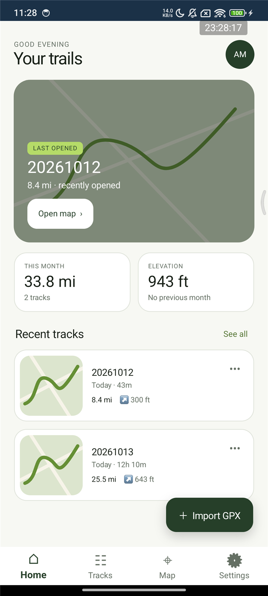
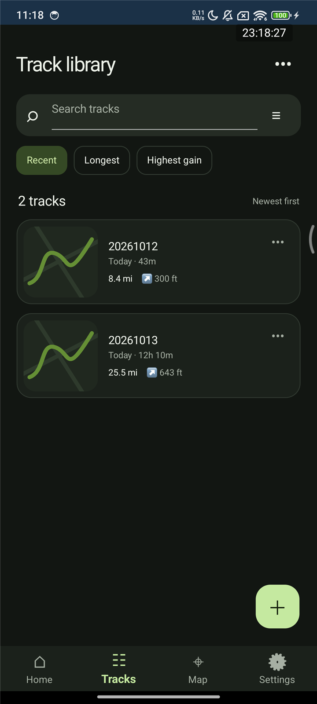
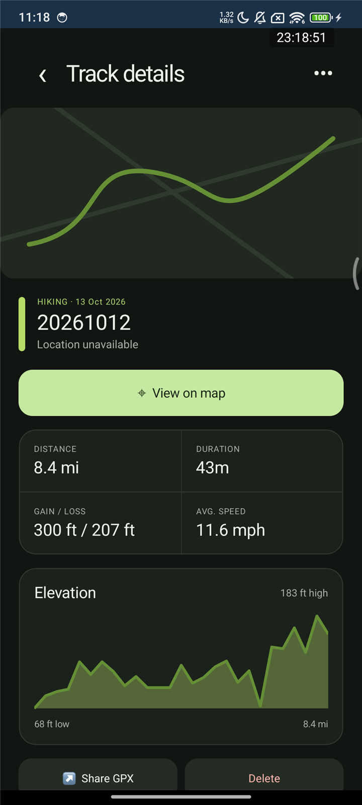
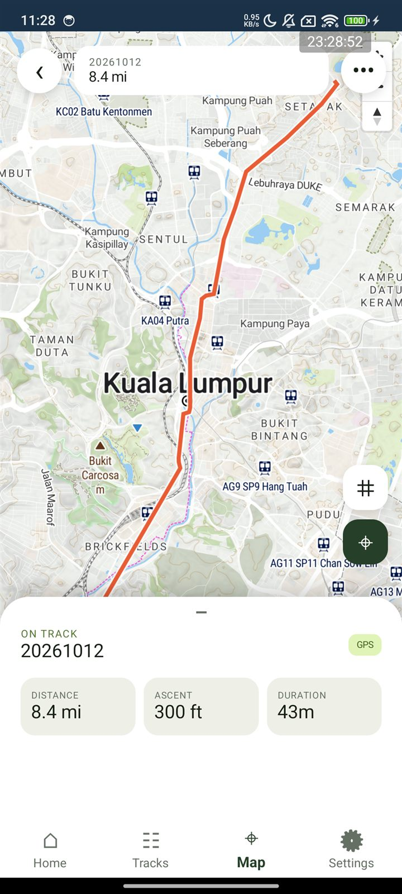
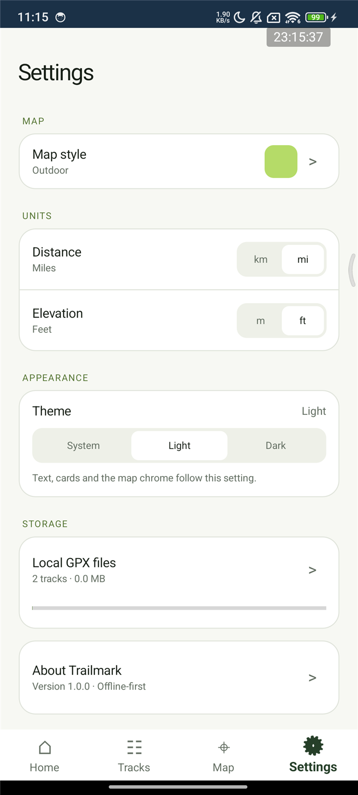
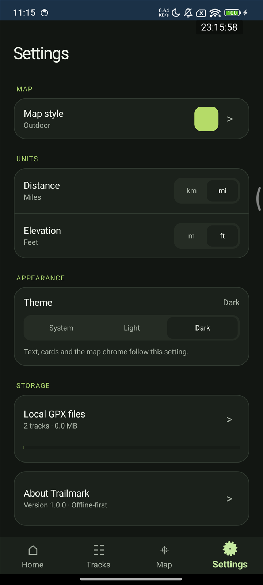
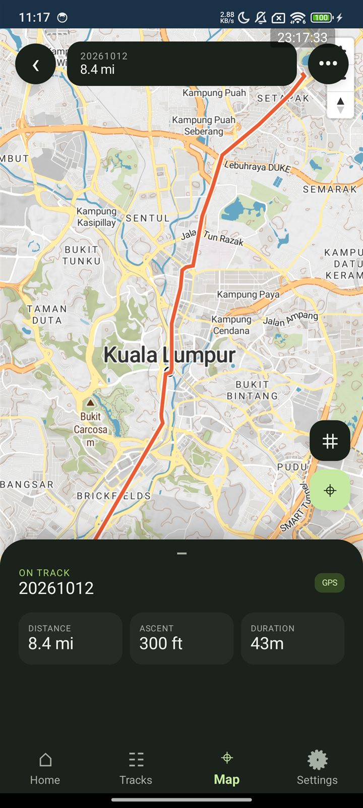

# Trailmark

**Your routes. Offline. Uncomplicated.**

Trailmark is a GPX viewer for Android. Import a `.gpx` file — exported from Strava, Komoot,
Garmin, a bike computer, or anywhere else — and see where you went: the route drawn on a real
map, how far you travelled, how long it took, and how much you climbed. Everything stays on your
phone. No account, no sign-in, no cloud, no ads.

## What you get

**A dashboard for your trails.** Open Trailmark and you're looking at the last track you had open,
this month's distance and elevation, and your most recent tracks. The avatar in the top-right goes
straight to Settings.

**A track library that stays tidy.** Every imported file becomes a card with a mini route preview,
distance and elevation. Search by name, or sort by newest, longest or biggest climb.

**Full track details.** Tap a track for distance, duration, total ascent and descent, average
speed, and an elevation profile of the whole route. From there you can open it on the map, share
the original file, or delete it.

**A real map, not a picture of one.** The map is MapTiler — the same cartography used by
professional outdoor maps — with your route drawn over it as a polyline and your waypoints as
markers. Pinch to zoom, drag to pan, tap the grid icon to fit the whole track on screen, or tap
the crosshair to centre on your own GPS position. Drag the sheet up for a compact stats panel with
the highest point and waypoint count.

**Keep your original files.** The `.gpx` file you imported is kept as it was, so you can share or
export it again whenever you like — and delete a track (and its file) when you're done with it.

**Makes itself at home.** Choose light, dark, or follow your phone. Distances in kilometres or
miles, heights in metres or feet, and four map styles to suit how you ride, walk or drive.

And if you prefer the dark side:

## Using Trailmark

1. **Import a track.** Tap **Import GPX** and pick a `.gpx` file from your device. Trailmark reads
   the points, elevation, timestamps, segments and waypoints in the background, so the screen never
   freezes — even for big files.
2. **Look around.** Your new track appears on the dashboard and in the library. Open it for the
   stats and elevation profile, then tap **View on map** to see it on the map.
3. **Share it back.** Use **Share GPX** on a track to send the original file to a friend or another
   app.

## Your data stays yours

- Tracks, track points, waypoints and your settings are stored in a local SQLite database in the
  app's private storage.
- The original `.gpx` files are kept locally as well, so nothing is lost when you import.
- The only thing that ever goes over the network is map tiles for the part of the map you are
  looking at. There is no analytics, no telemetry and no account system.

## Frequently asked

**The map says "MapTiler key required".**
Trailmark draws its maps with MapTiler, which needs an API key. The key isn't part of the published
source code, so a copy built without one can't fetch tiles. Everything else in the app still works.

**The map is grey or empty.**
Tiles are streamed as you pan, so check that you have a working internet connection. Everything
else in the app — your tracks, stats, elevation profiles and settings — works completely offline.

**There is no blue dot for my position.**
Location is only requested when you tap the crosshair button on the map. If you denied the prompt
earlier, allow location for Trailmark in Android Settings; the badge on the map sheet will tell you
whether it has been denied.

**Do I need an account?**
No. There is nothing to sign up for and nothing to sign in to.

**Where are my files kept?**
In Trailmark's own app storage, which other apps cannot read. They are removed from the device when
you delete the track.

## Requirements

- Android 8.0 (API 26) or newer
- Internet access for map tiles
- Optional: location permission if you want to centre the map on yourself

## Credits

- Maps © [MapTiler](https://www.maptiler.com/), map data ©
  [OpenStreetMap](https://www.openstreetmap.org/copyright) contributors
